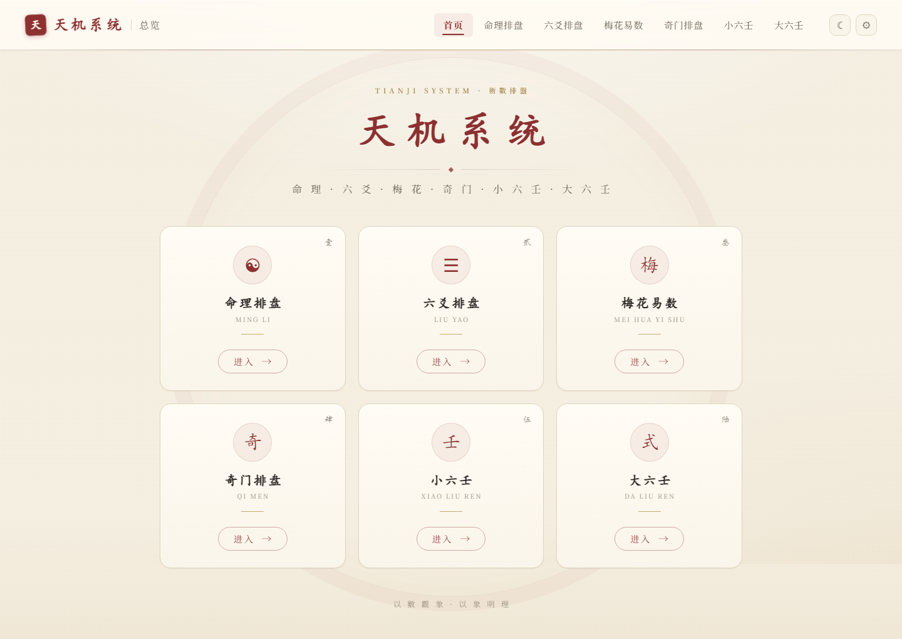
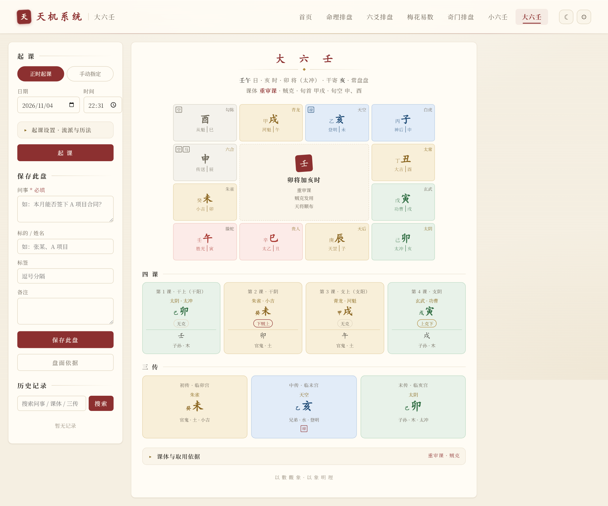

# TianJi

<p align="center"><sub>Numbers for the images · images for the principle</sub></p>

<p align="center"><sub><a href="README.md">简体中文</a> · <b>English</b></sub></p>

TianJi is a divination charting tool that runs on your own computer. Six traditional Chinese methods — BaZi & Zi Wei (destiny), Liu Yao, Mei Hua Yi Shu, Qi Men Dun Jia, Xiao Liu Ren, Da Liu Ren — live in one place. Enter a time, click once, and the chart appears. Everything you cast is stored locally, so you can come back later to add notes and tags.

It does exactly two things: **cast the chart correctly**, and **show you the reasoning**. At any given moment the six methods disagree with each other — Qi Men determines its *ju* either by the *chaibu* or the *zhirun* method, Da Liu Ren fixes the monthly general by either the *zhongqi* or the *jieqi* boundary, Xiao Liu Ren splits into the Jiang and Daochuan lineages. Those differences are switchable and visible here, so you never have to pick one piece of software and accept its single school of thought.

<p align="center"><sub>Python 3.10+ · runs locally · no sign-up · your data never leaves your machine</sub></p>

## Preview

<p align="center">
  
  <br><sub>Home · six methods, two rows of three</sub>
</p>

<p align="center">
  
  <br><sub>Da Liu Ren · monthly general on the hour, heaven-and-earth plate, four lessons and three transmissions</sub>
</p>

## What each method gives you

| Module | What it casts | How to start |
| --- | --- | --- |
| Destiny | BaZi: four pillars, Ten Gods, hidden stems, Na Yin, spirits, elemental strength, luck pillars and annual cycles. Zi Wei Dou Shu: twelve palaces, four transformations, major and annual limits | Enter birth date, time and gender; switch between BaZi and Zi Wei on the same page |
| Liu Yao | Primary hexagram, changed hexagram, six spirits, self and response lines, moving lines, six relatives | Specify six lines, or cast randomly (one or several times); the Gregorian time and the month/day stems may be set manually |
| Mei Hua Yi Shu | Primary, nuclear and changed hexagrams, moving line; the five body-versus-use judgements and seasonal strength | Cast by time, by two reported numbers, or by choosing the trigrams and moving line by hand |
| Qi Men Dun Jia | Nine palaces, eight gates, nine stars, eight spirits, chief star and chief gate; four layers (spirit, heaven, human, earth) | Hour, day, month or year charts; previous / next / current moment / custom |
| Xiao Liu Ren | Jiang lineage: six-palace palm chart with six relatives, six spirits, five stars. Daochuan: three-talents chart judged by body and use | Cast from day and hour, or from reported numbers; switch lineage at any time |
| Da Liu Ren | Twelve palaces of the heaven-and-earth plate, four lessons, three transmissions, twelve generals, hidden stems and six relatives | Cast on the current moment, or set the day pillar, hour and monthly general by hand |

## Installation

Three things: Python, this project, a few packages.

1. **Install Python 3.10 or newer** ([python.org](https://www.python.org/downloads/)). On Windows, tick "Add Python to PATH" during setup.
2. **Get the project**: `git clone`, or use Code → Download ZIP on the GitHub page.
3. **Install dependencies and start**:

```powershell
cd TianJi
pip install -r requirements.txt
python main.py
```

Open <http://127.0.0.1:5000> and you are on the home page. The database is created automatically on first launch — there is no schema script to run.

**If it will not start**

- `'python' is not recognized`: on Windows try `py main.py`; on macOS / Linux try `python3 main.py`
- Slow `pip` downloads: `pip install -r requirements.txt -i https://pypi.tuna.tsinghua.edu.cn/simple`
- Port 5000 already in use: stop whatever holds it, or change the port in `run_web()` in `core/web.py`
- Isolated environment: `python -m venv .venv`, activate it, then install the dependencies

## How to use it

The six pages work alike: fill in the parameters, read the chart; the save area and the record list sit on the same page.

### Destiny

Enter the birth date, time and gender, and you get two charts: **BaZi** (four pillars, Ten Gods, hidden stems, Na Yin, void branches, spirits, element counts with seasonal strength, luck pillars and annual cycles) and **Zi Wei Dou Shu** (twelve palaces with their stars, four transformations, major and annual limits). Switch between them in place; both share the same birth data.

- Hour unknown: tick "hour pillar unknown" — the hour pillar is left blank and everything else is still calculated
- Born away from 120°E: enter the longitude for true solar time correction, or enter the minute offset directly
- Different from your usual method: the four pillars can be corrected by hand
- Records can be tagged, searched, switched and deleted on the same page

### Liu Yao

Three ways to cast: **specify six lines** (six digits, one per line), **single random cast**, **repeated random casts**. The Gregorian time and the month and day stems can also be set manually.

The chart shows the primary hexagram, the changed hexagram, the six spirits, self and response lines, moving lines and the six relatives. Records are kept in per-year tables and can be searched by year, date, subject or person.

### Mei Hua Yi Shu

Three ways to cast: **by time** (numbers of year, month, day and hour), **by numbers** (report two), **manually** (to replay a classical case).

You get three hexagram cards — primary, nuclear, changed — with the moving and changed lines marked. The trigram holding the moving line is *use*, the other is *body*; the five judgements run "use generates body / same element / body controls use / body generates use / use controls body", together with a reference reading of the changed hexagram and seasonal strength.

- **Year-branch boundary** is switchable: first day of the first lunar month (lunar year, default) or Start of Spring (sexagenary year)

### Qi Men Dun Jia

Choose **hour / day / month / year chart** first, then page through with "previous / next / current time / custom" — switching does not reload the page.

The plate is drawn in four layers — **spirit, heaven, human, earth** — which can be viewed separately. The "annotations" toggle controls hidden stems, the travelling horse, the six instruments suffering punishment, entombment and gate coercion.

- The *ju* number carries a note on how it was derived (*zhengshou* / *chaoshen* / *jieqi*); hover to read it, and the "basis" panel sets out the full derivation
- In the custom panel you can set: *ju* method (*chaibu* / *zhirun*), year boundary (Start of Spring / lunar new year), true solar time (longitude and equation of time), the 23:00 day rollover, and whether the day chart continues past the three *yuan*
- Saving requires a **question** (what you are asking about); subject, tags and notes are optional

### Xiao Liu Ren

Pick **Jiang** or **Daochuan** first, then a way to cast:

- Jiang: from day and hour (count from the first day to the day, then from the day palace starting at *zi* to the hour), or report one number for the day
- Daochuan: from month, day and hour in three talents, or report three numbers

Jiang produces the six-palace palm chart (branches, six relatives, six spirits, five stars, self relatives); Daochuan produces heaven, earth and human palaces, judged by their mutual generation and control and by body and use.

### Da Liu Ren

**Cast on the moment** for the present time, or **set it by hand** — day pillar, hour and monthly general — to replay the classical cases recorded only as "such a day, such a general, such an hour".

The plate carries twelve palaces of the heaven-and-earth board (generals, hidden stems, heaven branches, the twelve branch spirits, earth palaces, void branches, travelling horse, day emolument), the four lessons, and the three transmissions (first, middle, last). Every chart includes a "basis" panel that walks through how the first transmission was chosen, step by step.

Under **casting settings** you can switch: monthly general (by *zhongqi* / by *jieqi*), Tianyi nobleman (common mnemonic / Yuan Shushan's *Tanyuan*), and *shehai* depth (counting method / the simpler *meng-zhong-ji* rule), plus longitude, equation of time and the 23:00 day rollover.

Saving requires a **question**; only the moment and the settings are stored, and history is recalculated from those settings.

## Records: how they are stored and found

- Every page has a save area and a record list; click an entry to bring back the chart as it was
- **Question** is mandatory for Qi Men, Mei Hua and Da Liu Ren; elsewhere a subject or a note is enough
- Search by question, subject, tag or chart type; notes can be edited and records deleted
- Any chart can be **copied as text**, **downloaded as text** or **saved as an image**
- Light and dark themes switch at the top right, and the choice carries across pages

## Why the same moment can produce different charts

The schools differ, so different charts for one moment are nothing unusual. This program's approach: **take one school by default, let the rest be switched, and write the reasoning on the chart itself.** Here is where the disagreements usually show up.

### Liu Yao · Destiny

- The year pillar changes at **Start of Spring** and the month pillar at the **solar term**, not at the lunar new year; the four pillars can be corrected by hand on both the Liu Yao and the Destiny page
- True solar time is derived from longitude and the equation of time and must be entered; birth time zone and daylight saving are not detected automatically
- Zi Wei Dou Shu is cast by the iztro library, and its lineage details follow that library

### Mei Hua Yi Shu

- **Year-branch boundary**: lunar new year (default) or Start of Spring, both selectable; they differ by one year between Start of Spring and the lunar new year
- **Number casting** follows the "sum of the two numbers, divided by six, gives the moving line" school; the alternatives ("add the hour number", "report three numbers separately") are not mixed in
- A cast at 23:00 belongs to the *zi* hour of the next day, and the year, month and day are taken from the next lunar day

### Qi Men Dun Jia

- ***Ju* method**: *chaibu* (default) and *zhirun* differ most visibly. On 2002-04-07 08:00, for instance, *zhirun* gives the Yang 6 chart of the Spring Equinox's lower *yuan*, while *chaibu* gives Yang 7 for the lower *yuan* of Clear and Bright — the whole chart differs. Both are available; which one you use is a matter of lineage
- **Year boundary**: Start of Spring (default, consistent with the month rule) or lunar new year; only the stretch between Start of Spring and the lunar new year is affected
- **Chief star**: taken as the original star of the palace where the *xunshou* falls. When it falls in the central palace it is recorded as Tian Rui (Tian Qin lodges in Kun 2 and shares that palace with Tian Rui); some textbooks write Tian Qin — two names for the same palace
- **Monthly chief gate** is placed on a fixed branch palace; some textbooks place the month branch in palace 2 instead. The reading used here is recorded in the "basis" panel
- **Hidden stems** follow the flying-palace school; the alternatives (stems inside the gates, stems for timing) are not implemented
- True solar time accounts for longitude and the equation of time only — no historical time zones, no daylight saving; 23:00–24:00 counts as the next day

### Xiao Liu Ren

- **The two lineages cast differently** — Jiang from day and hour, Daochuan from month, day and hour — so the palaces differ by construction
- **The elements of Liulian and Xiaoji** have several readings. Both palaces are water here (the Jiang Chunyi line; two waters side by side is not a typo), which differs from the "Liulian earth / Xiaoji water" found in some mnemonics
- **The six spirits** are arranged differently: Jiang starts the Azure Dragon from the day branch and proceeds in order; Daochuan fixes one per palace

### Da Liu Ren

- **Monthly general**: by *zhongqi* (default) or by *jieqi*; charts differ by a few days around each boundary
- **Tianyi nobleman**: the common mnemonic (Jia, Wu, Geng — ox and goat; default) or Yuan Shushan's *Tanyuan*; day/night assignment and forward/reverse order may differ
- ***Shehai* depth**: the counting method (default, *Liuren Daquan · Guanyue Jing*) or the simpler *meng-zhong-ji* rule; individual cases may select a different transmission
- **Fan Yin** takes the middle and last transmissions as "the clash of the first, the clash of the middle"; a variant takes "the punishment of the middle" as the last
- Day and night noblemen are assigned by the hour branch (*mao* through *shen* being day), not by actual sunrise and sunset; personal destiny, annual progression and the full spirit catalogue are not implemented

## Your data stays with you

Records live in `tianji.sqlite3` inside the project folder — one file, and copying it is your backup.

- **Moving computers**: copy `tianji.sqlite3` along with the project, install the dependencies, and carry on
- **Storing it elsewhere**: point the `TIANJI_DB_PATH` environment variable at any path
- **Offline**: casting itself needs no network — everything is computed locally; only "save as image" and some Qi Men scripts load from public CDNs, so those two may fail without a connection. Nothing about your chart is uploaded anywhere
- **LAN access**: the app listens on localhost only. Changing `run_web()` in `core/web.py` to `0.0.0.0` lets other devices on the network in, but there is no authentication — think twice on a shared network

## Known limits

- It casts charts, it does not judge outcomes: no timing predictions, no verdicts on fortune — the reading is still yours to make
- Spirits, configurations and chart types cover a common set, not the complete tables
- The Qi Men *zhirun* method adds an intercalary *qi* by whole three-*yuan* blocks at Grain in Ear and Major Snow rather than stepping day by day through an ephemeris, so a few dates may differ by one *ju* from dedicated software
- True solar time has no historical time zones and no daylight saving
- Solar terms and the sexagenary cycle are all computed locally, never fetched

## Troubleshooting

**Code changed, nothing happens**: Python files under `core/` and `modules/` need a restart; templates and static files only need a browser refresh.

**Blank chart or dead buttons**: usually the browser cache or a CDN script that failed to load — force a refresh (Ctrl+F5) or check the connection.

**An old record opens to a different chart**: history is recalculated from the settings saved at the time. If those settings differ from today's defaults, the chart will differ — this is intentional.

**Starting over**: quit the app, delete `tianji.sqlite3`, and the next launch creates an empty database.

## For anyone changing the code

Front-end conventions, directory layout, the algorithmic choices behind each module, the database schema, the verification cases and the remaining boundaries are all in **[docs/DEVELOPER.md](docs/DEVELOPER.md)** (currently in Chinese). Before touching an algorithm, read the "verification cases" and "remaining boundaries" subsections for that module.

## Disclaimer

This is a work of reading and self-verification, not a fortune-teller's trade. Every chart is derived from publicly transmitted rules of the traditional arts; its use is confined to cultural study and personal reflection, and **it is no basis for deciding an affair, treating an illness, pursuing a lawsuit or making an investment**.

That one chart may be read differently is common, ancient and modern alike. Each chart states the lineage it follows and the steps by which it was derived, so that anyone may check it — no claim is made to the single correct reading.

The software is provided "as is", without warranty of any kind, express or implied; the author accepts no liability for any gain or loss arising from its use.
