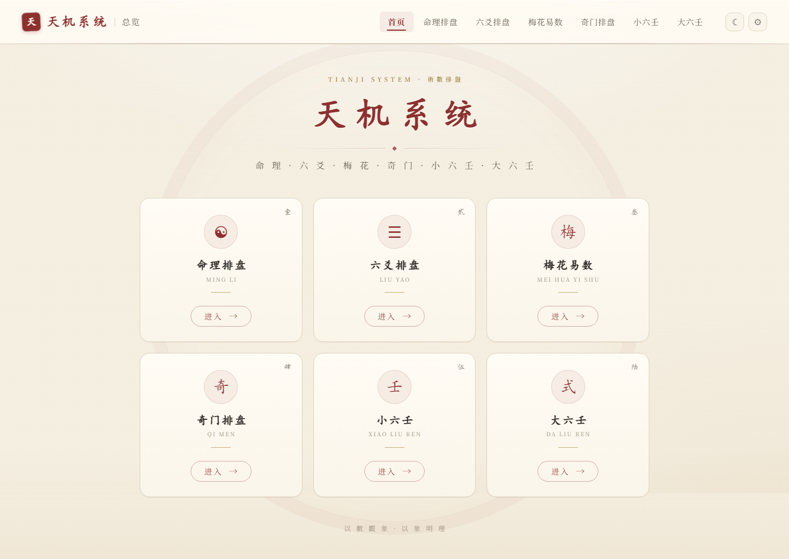
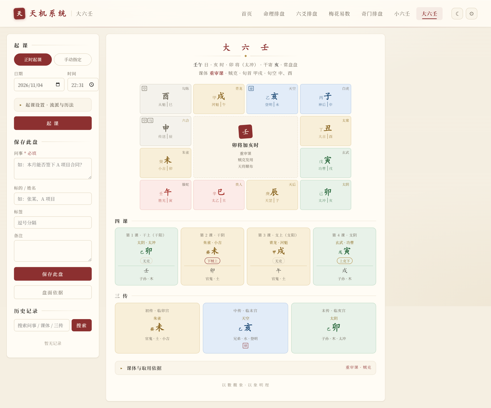

# 天机系统

天机系统是一个本地运行的玄学排盘工具，目前包含 **命理（八字 + 紫微斗数）**、**六爻**、**梅花易数**、**奇门遁甲**、**小六壬**、**大六壬** 六大术数模块。项目提供 Web 页面用于录入信息、生成排盘结果、保存记录、查询历史记录，并支持备注维护、复制文本、下载文本和保存图片。

项目使用 Python 内置的 SQLite 数据库，无需安装数据库服务。数据库文件为项目目录下的 `tianji.sqlite3`，应用启动时会自动初始化。因此项目可以作为一个开箱即用的本地工具复制到任意目录运行。

`Python 3.10+` · `Flask` · `SQLite` · `html2canvas` · 纯本地运行，无登录、无云端、数据不出本机

## 预览

<p align="center">
  
  <br><sub>首页 · 六大模块入口</sub>
</p>

<p align="center">
  
  <br><sub>大六壬 · 月将加时天地盘、四课与三传</sub>
</p>

## 快速开始

```powershell
git clone https://github.com/AbelardZ/LiuYao.git
cd LiuYao
pip install -r requirements.txt
python main.py
```

浏览器打开 <http://127.0.0.1:5000> 即可使用。首次启动会自动建库，之后所有排盘记录都写在本机 `tianji.sqlite3` 里；虚拟环境、局域网访问、自定义数据库路径等细节见「[安装与运行](#安装与运行)」与「[部署方式](#部署方式)」。

## 六大模块

| 模块 | 入口 | 核心内容 |
| --- | --- | --- |
| 命理 | `/mingli` | 八字四柱、十神、藏干、纳音、大运流年；紫微斗数十二宫、四化、大限流年；共享档案、页内切换 |
| 六爻 | `/liuyao` | 主卦/变卦、六神、世应、动爻、六亲，历史记录按年份分表 |
| 梅花易数 | `/meihua` | 时间 / 数字 / 手动三种起卦；本卦、互卦、变卦与动爻；体用生克五断、变卦参考与月令旺衰 |
| 奇门遁甲 | `/qimen` | 时家/日家/月家/年家，九宫布局、八门、九星、八神、值符值使，3D 盘面 |
| 小六壬 | `/xiaoliuren` | 江氏 / 道传 两派；江氏六宫掌盘（地支、六亲、六神、五星、自身六亲），道传三才三宫与体用 |
| 大六壬 | `/daliuren` | 月将加时天地盘、四课、九宗门三传、十二天将顺逆、旬遁干／六亲／旬空／驿马／日禄；正时与手动两种起课、三类流派选项 |

### 小六壬两派取法

两派在起课与六宫五行上各有定法，页面可按需切换：

| | 江氏 | 道传 |
| --- | --- | --- |
| 起课 | 日时：大安起初一数至农历日 → 日宫；日宫起子时数至时辰 → 时宫（身宫） | 月日时：大安起正月 → 月宫（天）；月宫起初一 → 日宫（地）；日宫起子时 → 时宫（人） |
| 数字起课 | 报一数代「日」，除六取余自大安起数定日宫，再以真实时辰起时宫 | 报三数，依次定月宫、日宫、时宫；体用之「用」仍取真实起课时辰 |
| 盘面 | 六宫掌盘：地支隔位顺排，装六亲、六神、五星，另取自身六亲 | 只立三宫，断三宫生克与体用 |
| 留连 | 属**坎水** | 属**坎水** |
| 小吉 | 属**坎水** | 属**坎水** |
| 六神 | 依「子午大安、丑未留连、寅申速喜、卯酉赤口、辰戌小吉、巳亥空亡」起青龙后顺排 | 本宫固定：大安青龙、留连腾蛇、速喜朱雀、赤口白虎、小吉玄武、空亡勾陈 |

> 六宫五行两派统一：大安木、留连水、速喜火、赤口金、小吉水、空亡土。其中留连、小吉两宫古来数说：江春义八卦配宫作留连坎水／小吉巽木（搜狗百科、太乙数小六壬对照表亦同），《明卦篇》作留连巽木／小吉坎水，民间通行口诀又作留连土／小吉水。本模块取留连、小吉俱为水——**江氏六宫之中两水并存，非笔误**。两派之别因此只在起课（日时 / 月日时）与盘面结构（六宫掌盘 / 三才三宫），不在五行。
>
> 江氏「兄弟」另有取法：隔位排支后，除土外不会出现同五行之支，故子午卯酉为身取第三宫、寅申巳亥为身取第二宫为兄弟，辰戌丑未为身则土土同类自明（理据为地支藏干与身支同类者）。
>
> 数字起课的定法各有出处：江氏依江春义《小六壬起课起卦装卦方法大全》——「不论求测人报多大的数，用这个数除以 6，用所得的余数从大安开始起课，然后再起时辰」，余 0 作 6（空亡）；时宫、地支、六亲、六神仍本于真实时辰，故报数只改日宫一位。道传依《道传小六壬排盘方法》——须以正时或三个随机数起课，「以时落宫为体，起课时辰为用」；三数虽代月日时之数，体用的「用」仍取真实时辰，不随时宫而改。

## 功能特性

### 通用

- 全站统一抬头「天机系统 ＋ 模块名」，七个导航项顺序与高亮一致（见「前端统一约定」）
- 主页 `/` 提供六大术数入口卡片
- 每个排盘页面内嵌历史记录列表，可直接切换、查询、删除
- 支持保存排盘结果、标的/姓名、标签和备注；奇门、梅花易数、大六壬保存须填写「问事」（必填）
- 支持复制排盘文本、下载文本、保存排盘图片（`html2canvas`）
- 统一的浅色/深色主题与设置面板，由 `tianji.js` 实现，切换状态在页面间保持一致
- 全站禁用浏览器缓存，修改前端代码后刷新即可看到最新效果

### 六爻

- 支持三种起卦方式：指定六爻、多随机、单随机
- 支持手动输入公历日期、时分、月柱和日柱干支
- 自动生成主卦、变卦、六神、世应、动爻等信息
- 历史记录按年份分表存放，支持按年份、日期、标的、用户查询

### 命理（八字 + 紫微斗数）

- 八字：四柱（年/月/日/时）、十神、藏干、纳音、空亡、神煞、五行统计与月令旺衰
- 八字：支持按阳男阴女规则排大运（顺行/逆行、起运岁数与起运日期）并展示未来十年流年
- 八字：支持手动校正四柱干支、真太阳时校正（分钟）、"时柱未知"排盘
- 紫微斗数：十二宫安星、四化飞星、大限/流年/流月/流日/流时（浏览器端 iztro 排盘）
- 八字与紫微共享同一套「命理档案」，页面内 tab 一键切换，无需重复录入出生信息
- 支持给记录添加标签，并在页面内搜索、切换、新增、删除记录

### 奇门遁甲

- 支持时家 / 日家 / 月家 / 年家四种排盘方式
- 支持上一局 / 下一局 / 当前时间 / 自定义时间切换，切换时不整页刷新
- 输出局数、旬首、值符、值使、九宫内容（八门、九星、八神、天地盘干）
- 九宫格使用 CSS 3D 变换呈现，支持导出为图片
- 保存记录须填写**「问事」**（所问何事，必填，口径与六爻「占事主题」一致），另可填标的 / 姓名、标签、备注；问事在基本信息、历史列表与记录编辑区同步显示，也可按问事搜索。旧记录的问事为空，可在历史页补记

### 梅花易数

- 三种起卦方式：**时间起卦**（年支数 + 农历月日 + 时辰数，卦以八除、爻以六分）、**数字起卦**（报两数定上下卦、两数之和定动爻）、**手动指定**（复盘经典卦例）
- 输出本卦 / 互卦 / 变卦三张卦卡（六爻图形、上下卦五行、卦意），动爻与变爻标出
- 体用：动爻所在之卦为用，不动之卦为体；给出「用生体 / 比和 / 体克用 / 体生用 / 用克体」五断，另附变卦参考与月令旺衰提示
- 年支分界可切**正月初一（农历年，默认）** / **立春（干支年）**；23:00 起属次日子时，年月日按次日农历取
- 保存记录须填写「问事」（必填），盘面由保存的时刻与起卦参数重算

### 小六壬

- **江氏** / **道传** 两派随时切换，起课、盘面与断法差异见上文「[小六壬两派取法](#小六壬两派取法)」
- 江氏：日时起课（大安起初一数至日 → 日宫起子时数至时辰）与报数起课（报一数代日）；六宫掌盘，地支隔位顺排并装六亲、六神、五星、自身六亲
- 道传：月日时三才起课、报三数起课；只立天／地／人三宫，断三宫生克与体用
- 输出六宫吉凶、五行生克与断语提示；可保存记录（时间、流派、起课方式、报数、标的、标签、备注）并在页面内检索、删除

### 大六壬

- 两种起课：**正时起课**（可选真太阳时校正、23:00 晚子时换日、按节气交接精确时刻换月将）、**手动指定**（日干支＋占时＋月将，用于复盘只给「某日某将某时」的古籍课例）
- 盘面：天地盘十二宫（天将、遁干、天盘支、十二支神、地盘宫、旬空／驿马／日禄标记）、四课四列、初中末三传三列，课式居中
- 九宗门全分支取三传：贼克（元首／始入／重审）、比用（知一）、涉害（见机／察微／缀瑕）、遥克（蒿矢／弹射）、昴星（虎视／冬蛇掩目）、别责、八专、伏吟、返吟；每盘在「盘面依据」给出可逐项复核的发用过程
- 三类流派选项：月将换将（**中气**默认／节气）、天乙贵人（**通行口诀**默认／袁树珊《探原》）、涉害（**《六壬大全·观月经》计害法**默认／邵彦和·陈公献孟仲季简法）；另有经度、均时差、23 点换日
- 保存须填「问事」（必填）；只存时刻与参数 JSON，历史按保存参数重算，可按问事／课体／三传／标的／标签搜索并编辑

## 前端统一约定

全站统一命名为「天机系统」。八个页面共用同一套抬头、设计变量与交互逻辑，不各自实现：

| 文件 | 职责 |
| --- | --- |
| `static/css/tianji.css` | 统一设计变量、纸面质感与公共组件（抬头、导航、设置面板、滚动条、焦点态、按钮过渡）。历史上首页、六爻、历史、命理用 `--bg-body` / `--primary-color`，奇门、小六壬用 `--paper` / `--vermillion`；此文件把两套别名映射到同一组取值，**须在各页 `<style>` 之后加载**才能覆盖其 `:root` 定义 |
| `static/js/tianji.js` | 统一主题逻辑：主题挂在 `<html data-theme>`（避免旧代码在 `<body>` 上设属性导致变量互相覆盖）、以 `localStorage['theme']` 持久化、同步按钮图标；对外提供 `toggleTheme()` / `openSettings()` / `closeSettings()`，并在 DOM 就绪后注入全站共用的设置面板 |
| `templates/_header.html` | 统一抬头：品牌「天机系统」＋当前模块名＋七个导航项＋主题按钮＋设置按钮。导航高亮由 `request.path` 自动判定（`/history` 归入六爻），页面无需传参 |
| `templates/*.html` | 各页 `<title>` 统一为「天机系统 · 模块名」；页面内只保留业务样式与业务脚本 |

新增页面时，在 `<head>` 末尾引入上述 CSS 与 JS，并在 `<body>` 顶部写 `` 即可，无需复制抬头代码或主题脚本。模块名、导航文案与顺序以 `_header.html` 为准。

### 视觉规范

- `tianji.css` 只做「变量映射 ＋ 增量润色」：极淡纸纹与暖光晕、朱金渐变饰线、毛玻璃 sticky 抬头、下划线导航、滚动条、键盘焦点环、设置面板入场动画。它不重写任何业务布局，盘面结构始终由各页 `<style>` 决定。
- `--wx-*`（木／火／土／金／水）是盘面语义色，**任何主题或配色调整都不得改动**；深色模式只覆盖中性变量（`--bg-*` / `--text-*` / `--primary-*` / `--border-*` / `--shadow-*`）。
- 首页 `templates/home.html` 单独承载品牌视觉：眉批、朱金分隔线、含蓄「天圆」装饰、六张序号卡（壹～陆）、圆形印章图标、箭头按钮与入场动画。卡片内只保留「图标 — 名称 — 英文 — 短线 — 进入」五层，不写说明文字；桌面端固定为**两排三列**——上排「命理 · 六爻 · 梅花」，下排「奇门 · 小六壬 · 大六壬」，1040px 以下收窄内距、880px 转两列、600px 转单列，并遵循 `prefers-reduced-motion`。导航顺序与卡序一致。
- 420px 窄屏下七个导航项压为一行（字号 0.68rem），避免末项单独换行居中。
- `tianji.js` 还会同步 `.tj-header.is-scrolled`，滚动时加深抬头阴影。

视觉预览：`outputs/preview_home_light.png`、`preview_home_dark.png`、`preview_home_mobile.png`、`preview_liuyao_light.png`、`preview_xiaoliuren_dark.png`。

## 技术栈

| 层级 | 技术 |
| --- | --- |
| Web 框架 | Flask |
| 页面模板 | Jinja2 / HTML / CSS / JavaScript |
| 数据库 | SQLite |
| 数据库驱动 | Python 标准库 `sqlite3` |
| 历法与干支 | `sxtwl`（六爻、八字）、`lunar-python`（奇门） |
| 紫微排盘 | `iztro`（浏览器端 UMD，`static/js/iztro-v2.6.1.min.js`） |
| 图片导出 | `html2canvas` |
| 运行环境 | Python 3.10+ |

## 项目架构

项目采用轻量分层结构：核心逻辑按术数拆分为独立模块，Web 装配层、数据库层、配置层与页面模板相互分离。

```text
.
├── main.py                  # 项目启动入口
├── requirements.txt         # Python 依赖
├── tianji.sqlite3           # 本地 SQLite 数据库（首次运行后自动生成）
├── core/                    # 系统装配层
│   ├── config.py            # 路径与数据库配置
│   ├── db.py                # SQLite 连接、建库建表、旧库迁移
│   └── web.py               # Flask 应用、路由与保存/查询接口
├── modules/                 # 术数业务模块
│   ├── liuyao/              # 六爻
│   │   ├── divination.py    # 排盘核心逻辑
│   │   └── data.py          # 卦象、干支、六亲、六神等基础数据
│   ├── bazi/                # 八字
│   │   ├── bazi.py          # 四柱与十神、大运等核心逻辑
│   │   └── bazi_data.py     # 天干地支、五行、十神、纳音、神煞等基础数据
│   ├── qimen/               # 奇门遁甲
│   │   ├── qimen.py         # 排盘主入口
│   │   ├── constants.py     # 常量与基础映射
│   │   ├── dipan.py         # 地盘布局
│   │   ├── jiuxing.py       # 九星
│   │   ├── bamen.py         # 八门
│   │   └── bashen.py        # 八神
│   ├── xiaoliuren/          # 小六壬（江氏 / 道传）
│   │   ├── data.py          # 六宫、五行、六神、五星等基础数据
│   │   └── xiaoliuren.py    # 起课与排盘逻辑
│   ├── meihua/              # 梅花易数
│   │   ├── data.py          # 先天八卦数、六十四卦名矩阵、卦意、五行体用
│   │   └── meihua.py        # 三种起卦、本互变三卦、体用生克与旺衰
│   └── daliuren/            # 大六壬
│       ├── data.py          # 干支五行、寄宫、月将、天将、贵人、刑冲合与九宗门口诀
│       └── daliuren.py      # 时间层、天地盘、四课、九宗门三传、天将遁干与盘面组装
├── templates/
│   ├── _header.html         # 全站统一抬头（Jinja include）
│   ├── home.html            # 首页：六大模块入口卡片（两排三列）
│   ├── liuyao.html          # 六爻排盘页面
│   ├── liuyao_history.html  # 六爻历史记录查询页面
│   ├── mingli.html          # 命理页面（八字 + 紫微斗数，页内 tab 切换）
│   ├── qimen.html           # 奇门排盘页面
│   ├── xiaoliuren.html      # 小六壬排盘页面（江氏 / 道传）
│   ├── meihua.html          # 梅花易数排盘页面（本互变三卦与体用）
│   └── daliuren.html        # 大六壬排盘页面（天地盘、四课、三传、取用依据）
├── static/
│   ├── css/
│   │   ├── tianji.css       # 全站统一设计变量与抬头样式
│   │   └── ziwei.css        # 紫微斗数盘面样式
│   └── js/
│       ├── tianji.js        # 全站统一主题与设置面板逻辑
│       ├── iztro-v2.6.1.min.js  # 紫微斗数排盘库（浏览器端）
│       └── ziwei.js         # 紫微斗数页面脚本
├── docs/                    # README 用截图
└── archive/                 # 归档目录（改造前的独立项目、旧模板与旧数据备份；已 gitignore，不进仓库）
```

## 核心模块说明

### `main.py`

项目启动入口。只负责调用 `core/web.py` 中的 `run_web()`，让启动方式与 Flask 内部结构解耦。

```powershell
python main.py
```

### `core/web.py`

Web 装配层，负责：

- 创建并配置 Flask 应用（模板目录、静态目录、禁用缓存）
- 应用启动时调用数据库初始化
- 渲染主页 `/`
- 六爻：`/liuyao`、`/save`、`/history`、`/history/view/<year>/<id>`、`/update_remarks`、`/history/delete`
- 命理：`/mingli`（八字 + 紫微斗数，`?tab=bazi|ziwei` 切换）、`/mingli/update_remarks`、`/mingli/delete`
- 奇门：`/qimen`、`/qimen/custom`、`/qimen/api`（JSON）、`/qimen/update_remarks`、`/qimen/delete`
- 小六壬：`/xiaoliuren`（`?school=jiang|dao`、`&method=time|number`、`&numbers=9`）、`/xiaoliuren/delete`
- 梅花易数：`/meihua`（`?method=time|number|manual`、`&numbers=37 82`、`&record_id=N`）、`/meihua/api`（JSON）、`/meihua/delete`
- 大六壬：`/daliuren`（`?method=time|manual`、`&day_gan=丁&day_zhi=未&shichen=巳&yuejiang=戌`、`&record_id=N`、`&q=关键词`）、`/daliuren/api`（JSON）、`/daliuren/update`（编辑问事）、`/daliuren/delete`
- 兼容重定向：`/bazi`、`/ziwei`、`/bazi/history` 等旧入口自动跳转到 `/mingli`

### `core/db.py`

SQLite 数据访问层，负责：

- 根据配置路径创建或连接数据库，并设置 `sqlite3.Row`
- 自动创建六爻年份表、`bazi_records` 表、`qimen_records` 表、`xiaoliuren_records` 表、`meihua_records` 表、`daliuren_records` 表
- 安全转义 SQLite 表名
- 首次运行时把旧的 `liuyao.sqlite3` 自动迁移为 `tianji.sqlite3`
- 提供 `initialize_database()`，在应用启动时准备数据库

### `core/config.py`

路径与数据库配置模块。默认数据库路径为：

```text
项目目录/tianji.sqlite3
```

也可以通过环境变量 `TIANJI_DB_PATH`（或兼容的 `LIUYAO_DB_PATH`）指定自定义数据库位置。

### 六爻模块 `modules/liuyao/`

- `divination.py` 把用户输入转换成排盘结果
- `data.py` 存放卦象、干支、六亲、六神等基础数据

### 八字模块 `modules/bazi/`

- `bazi.py` 把出生时间、性别转换成四柱并计算十神、藏干、纳音、空亡、神煞、五行统计、月令旺衰、胎元/命宫/身宫、大运与流年
- `bazi_data.py` 存放天干地支、阴阳五行、藏干、十神、纳音、神煞、五虎遁等基础数据

八字相关计算说明：

- 年柱以立春为界，月柱以节气为界（`sxtwl` 计算，支持手动覆盖四柱）
- 大运顺逆：阳年男 / 阴年女顺排，阴年男 / 阳年女逆排；起运按出生到最近“节”的时间折算（3 天折 1 年，1 天折 4 个月，1 时辰折 10 天）
- 空亡按六甲旬空逐柱计算；神煞以年支/日支与日干为锚点查表
- 日主强弱为简易判定：按八字八位统计“印比”与“克泄耗”计数对比
- 真太阳时校正为手动输入分钟数（可正可负），不自动按出生地校准；时柱未知时不应用校正
- 时柱未知时，时柱显示“未知”，五行统计按六位计算，命宫/身宫显示“未知”，大运与流年照常计算

### 奇门模块 `modules/qimen/`

- `qimen.py` 是排盘主入口，暴露 `calculate(date, options)`，返回包含 `basicInfo`、`siZhu`、`juShu`、`xunShou`、`zhiFuXing`、`zhiShiMen`、`jiuGongAnalysis` 等字段的字典；地盘三奇六仪由 `distribute_san_qi_liu_yi()` 计算
- 历法与干支计算基于 `lunar-python`
- `jiuxing.py`、`bamen.py`、`bashen.py` 分别负责九星、八门、八神；`dipan.py` 为历史遗留草稿，**未参与计算**（仅被 import、从未调用），其固定盘与注释均有误，勿据以理解地盘规则
- `timeutil.py` 负责真太阳时、晚子时进位与节气精确交接时刻；`geju.py` 负责暗干、驿马与格局标注
- 起局选项由 `core/web.py` 的 `_parse_qimen_options()` 统一解析（主页／自定义／API／保存共用），`qimen_records.取法` 以 JSON 保存，历史记录按其保存时的取法重算
- Web 层通过 `/qimen/api` 返回该字典的 JSON，供前端局部刷新

排盘规则（2026-11-04 核对，依《遁甲演义》《奇门遁甲统宗》《精通奇门遁甲》一系）：

**四家共用**：地盘从局数宫起，按戊己庚辛壬癸丁丙乙阳顺阴逆排布（`distribute_san_qi_liu_yi()`）；值符星＝旬首所落地盘宫的元旦盘九星（蓬任冲辅英芮柱心对应 1/8/3/4/9/2/7/6 宫），值符随**本柱天干**落宫；九星与八门不论阴阳遁一律按固定队形顺时针旋转，仅八神阳顺阴逆；旬首或落宫干在中宫一律寄坤二，天禽随天芮同宫；中宫不排门、神。

| 方法 | 定局 | 值使落宫 |
| --- | --- | --- |
| 时家 | 拆补法：当日节气查 `constants.JIE_QI_JU_MAP`，符头（甲己日）地支按子午卯酉／寅申巳亥／辰戌丑未定上／中／下元 | 旬内序号从旬首宫起，在九宫（含中宫）阳顺阴逆飞宫 |
| 日家 | 冬至后阳遁、夏至后阴遁；以最接近二至的甲子日起，60 日一元，依次用阳 1/7/4 或阴 9/3/6 局 | 随日支加临地支宫 |
| 月家 | 60 月（五年）一元、纯阴遁；甲己符头年的年支四孟／四仲／四季定上／中／下元，起阴 1/7/4 局 | 随月支加临地支宫 |
| 年家 | 60 年一元、纯阴遁；上元甲子 1864 年起，上／中／下元分别阴 1/4/7 局，一局用满 60 年 | 随年支加临地支宫 |

- **值使随支加临**依《奇门遁甲统宗》「看月建之支临于地盘何宫，即以天盘值使加之」，地支宫位见 `constants.ZHI_GONG_MAP`（子坎一、丑寅艮八、卯震三、辰巳巽四、午离九、未申坤二、酉兑七、戌亥乾六）。`bamen.py` 的 `zhi_gong` 参数为 `None` 时才走时家飞宫。
- 月家定元的年干支按**立春分界**（`getYearInGanZhiByLiChun()`），与节气月建一致，避免立春～春节窗口错配。
- `juShu.note` 记录起局依据（元首年／甲己符头／基准甲子），页面「局数」悬停可见，也可从 `/qimen/api` 读取。

校核用例：

- 时家：按经典例的阳遁六局地盘手算对照，2002-04-07 08:00 庚辰时（甲戌旬）值符天柱落艮八、值使惊门落巽四，九星／八门／八神逐宫一致。该例出自**置闰法**（春分下元阳六局），本项目用拆补法在同一时刻会得到阳七局，故此项只校验转盘算法、不校验定局。
- 年家：2004-08-06 甲申年，下元阴七局，地盘 7戊 6己 5庚 4辛 3壬 2癸 1丁 9丙 8乙，九星与八门皆伏吟，八神自坤二起逆排，值使死门随年支申落坤二——与易德轩局例逐项吻合。
- 日家：2002-02-26 乙丑日为中元阳七局、2002-10-24 乙丑日为下元阴六局，与《精通奇门遁甲》例题判定的中元／下元一致（例题正文中「中元四局」「下元阴九局」与其自身规则一七四／九三六冲突，属笔误）。
- 另有 48 条元期恒等断言与 96 组（四方法 × 24 时刻）自洽校验：九干／九星／八门／八神／天盘干不重不漏，值符宫等于落宫干所在宫、值使宫等于地支宫，宫位说明文案完整。

起局精度（2026-11-04 补齐，均可在「自定义排盘 → 起局设置」或 URL 参数中指定）：

| 选项 | 默认 | 说明 |
| --- | --- | --- |
| `longitude` / `eot` | 空 / 叠加 | 真太阳时 = 钟表时 + (东经 − 120°)×4 分 + 均时差（NOAA 近似式，年内误差约 ±0.3 分）；留空即按北京时间 |
| `late_zi` | 启用 | `lunar-python` 日柱 00:00 换日、时柱 23:00 换日，23:00–24:00 四柱自相矛盾；启用后该时段整体进位次日 00:00（时辰仍为子时），四柱、旬首、旬空、定局取同一基准 |
| `year_rule` | 立春 | 年柱、年家太岁／旬首／值使统一按立春分界，与节气月建一致；可切回农历正月初一 |
| `ding_ju` | 拆补 | 时家可选「置闰」：以完整三元段（15 天，起于不晚于当日的最近上元符头）所属节气查局数表，段内节气交接不中途换表，超神与接气自然沿用旧局；超神过九且在芒种／大雪时行闰奇，重复该节气三元。`juShu.chaoJie` 给出正授／超神／接气与天数 |
| `ri_run` | 延续 | 日家逾三元（半年约 183 日 > 180 日）时第三元延续至下一二至，不再周而复始跳回上元；可切回旧行为 |

节气交接按 `getJieQiTable()` 的精确时刻（到秒）判断，不再按日粒度。以上口径均写入 `timeInfo`、`juShu.note`、`basicInfo.timeNote`，页面「取法」常显，悬停与「盘面依据」面板可查完整依据。

盘面标注（`geju.py`，可用控制栏「标注」开关隐藏）：

- **暗干**：飞宫法，本柱天干加值使门落宫，按戊己庚辛壬癸丁丙乙阳顺阴逆飞布九宫；值使门宫地盘干与本柱干相同时入中宫后再飞。
- **驿马**：按本柱地支三合取马（时家取时支），申子辰→寅艮八、寅午戌→申坤二、巳酉丑→亥乾六、亥卯未→巳巽四。
- **六仪击刑**：戊震三、己坤二、庚艮八、辛离九、壬巽四、癸巽四（天盘干加临相刑之宫）。
- **入墓**：乙乾六／坤二、丙乾六、丁艮八；戊乾六、己艮八、庚艮八、辛巽四、壬巽四、癸坤二。
- **门迫／门制**：门克宫为迫、宫克门为制；杜门五行属木（旧常量表误作土，会让「伤杜临二八宫」漏判，已修正）。
- **旬空**：按本柱六十甲子统一计算，不依赖 `lunar-python` 各柱接口差异。
- 中宫无门无神，除暗干外不参与格局判断；吉凶分级仍按八门简化。

补充校核：

- 置闰法经典例：2002-04-07 08:00 得春分下元阳六局，值符天柱落艮八、值使惊门落巽四，与教材局例逐宫吻合（拆补法同刻为清明下元阳七局）。
- 23 点换日：2026-11-04 23:30 日柱癸未、时柱壬子，与次日 00:30 一致；关闭后回到旧行为壬午／壬子（四柱错配）。
- 真太阳时：东经 90° 时差 −120 分；东经 118.8°（2002-04-07）合计 −7.3 分。
- 64 组（四方法 × 拆补／置闰 × 8 时刻）批量自洽与格局表逐项对照零失败；历史记录取法回显、7 组浏览器校验（浅／深／420px／带选项）零控制台错误、零横向溢出。

剩余边界：

- 置闰法按「完整三元段 + 芒种／大雪闰奇」实现，未逐日递推万年历闰奇，也未行「接不过五」的独立调整；与部分软件的置闰局可能有数日差异。
- 真太阳时只按经度与均时差校正，未做时区、夏令时与时区历史变更处理；晚子时进位把 23:00–24:00 映射到次日 00:00，节气判断仍用校后原始时刻。
- 部分网络教材的月家例题称「月支落二宫、值使伤门落二宫」，与九宫固定地支宫（巳→巽四）不符；本实现依《奇门遁甲统宗》按固定地支宫加临，此口径在「盘面依据」面板中明示。
- 旬首落中宫时值符星记作**天芮**（天禽寄坤二、与天芮同宫），部分教材记作「天禽」，属同一落宫的不同表述；`zhiFuXingNote` 会给出说明。
- 暗干为转盘飞宫法一系，另有「八门含干」「应期干」等异说未实现；未实现天盘干克应格局（青龙返首、白虎猖狂等）、伏吟／反吟自动标注与应期推断；吉凶判断仍按八门简化分级。

### 梅花易数模块 `modules/meihua/`

- `data.py` 存先天八卦数（乾一…坤八）、八卦爻象与五行、六十四卦名矩阵（与 `modules/liuyao/data.py::gua64` 逐卦交叉校验一致）、六十四卦象义、体用五断与月令旺衰表
- `meihua.py` 暴露 `calculate(dt, method, numbers, manual, year_rule)` 与 `summary_of(pan)`：起卦 → 本卦 → 动爻翻转得变卦 → 二三四爻为下互、三四五爻为上互得互卦 → 体用生克、变卦参考与旺衰提示
- 历法与干支基于 `lunar-python`；23:00 起属次日子时，年月日按次日农历取（时辰仍为子时）
- Web 层 `/meihua`（主页／保存）、`/meihua/api`、`/meihua/delete`；`meihua_records.参数` 以 JSON 保存起卦方式、报数、手动卦与年支分界，历史按保存参数重算

起卦规则（2026-11-04 核对，依《梅花易数》先天数一系）：

| 方式 | 上卦 | 下卦 | 动爻 |
| --- | --- | --- | --- |
| 时间起卦 | (年支数 + 农历月 + 农历日) ÷ 8 取余 | (上三数 + 时辰数) ÷ 8 取余 | 四数之和 ÷ 6 取余 |
| 数字起卦 | 第一数 ÷ 8 取余 | 第二数 ÷ 8 取余 | 两数之和 ÷ 6 取余 |
| 手动指定 | 直接选经卦 | 直接选经卦 | 直接选 1–6 爻 |

年支数子 1…亥 12，时辰数子 1…亥 12；**卦除 8 余 0 作 8（坤）、爻除 6 余 0 作 6（上爻）**。动爻所在之卦为用、另一卦为体；八卦五行取经卦本气（乾兑金、震巽木、坎水、离火、坤艮土），不用纳甲地支五行。

校核用例：2024-04-23（甲辰年三月十五）午时 → 山水蒙，上爻动 → 变地水师、互地雷复，体坎水／用艮土为「用克体」；2016-05-17（丙申年四月十一）巳时 → 余 0 作 8 与 6，得地水师、上爻动变山水蒙；报数 37、82 → 风泽中孚、第五爻动。另有 384 组（64 卦 × 6 动爻）批量自洽与经典例回归，零失败。

剩余边界：

- 数字起卦只取「两数之和除六定动爻」一系；「两数之和加时辰数」与「报三数分别定上／下／动」两说未混用，也未实现声音、字画、方位等起卦法。
- 月令旺衰仅按节气月支的旺相休囚死作简化参考，未计日辰、外应与卦气深浅；体用断语只是五行生克的倾向，不替代具体占断。
- 未实现应期、错卦／综卦、万物类象断语；闰月按当月月数取，不另加数。
- 时间取本地钟面时间，未做真太阳时校正；立春～春节之间两种年支分界（正月初一／立春）可切换。

### 大六壬模块 `modules/daliuren/`

- `data.py` 存干支五行、十干寄宫、两套月将表、十二支神、十二天将、两套昼／夜贵人口诀、刑冲合／三合／驿马／日禄与九宗门口诀
- `daliuren.py` 暴露 `calculate(dt, method, manual, options)`、`build_pan(day_gz, shichen, yuejiang, ...)`、`current_yuejiang(date, rule)`、`summary_of(pan)`：时间层 → 天地盘 → 四课 → 九宗门三传 → 天将 → 旬遁干／六亲／旬空／驿马／日禄 → 盘面组装
- Web 层 `/daliuren`（主页／保存）、`/daliuren/api`、`/daliuren/update`、`/daliuren/delete`；`daliuren_records.参数` 以 JSON 保存起课方式、手动指定与流派选项，历史按保存参数重算

排盘规则（2026-11-04 核对，依《六壬大全》九宗门与袁树珊《大六壬探原》月将分界）：

| 步骤 | 口径 |
| --- | --- |
| 月将 | **中气**换将（雨水亥、春分戌、谷雨酉、小满申、夏至未、大暑午、处暑巳、秋分辰、霜降卯、小雪寅、冬至丑、大寒子），按 `lunar-python` 节气表**精确交接时刻**判定；可切节气派（清明酉、立夏申、芒种未…） |
| 天地盘 | 月将加占时顺布，地盘 `x` 之上神为 `(x + 月将 − 占时) mod 12`；偏移 0 为伏吟、6 为返吟 |
| 四课 | 一课干上（日干寄宫上神／日干）、二课干阴、三课支上、四课支阴；寄宫「甲寅乙辰丙戊巳、丁己未庚申辛戌壬亥癸丑」。**第一课下神按天干五行**论克 |
| 三传 | 先取下贼上，无贼取上克下；多处克用比用（与日干同阴阳），俱比／俱不比用涉害；无克用遥克；再昴星、别责（三课）、八专（干支同位）；伏吟／返吟优先，中末按递刑／取冲。常规中传＝地盘初传宫上神，末传＝地盘中传宫上神 |
| 涉害 | 计害法：自候选所临地盘宫的**下一宫**顺行至本家宫止，逐宫计入本气与十干寄宫之干；下贼上计「地盘克神」、上克下计「神克地盘」，取重数多者；并列再论孟＞仲＞季，仍并列则刚日取干上神、柔日取支上神。另有孟仲季简法可选 |
| 天将 | 昼（卯辰巳午未申）／夜（酉戌亥子丑寅）贵；贵人所乘天盘支落在地盘亥子丑寅卯辰则**顺布**、巳午未申酉戌则**逆布**；十二将配在**天盘支**上 |
| 遁干 | 旬遁：自旬首地支起甲顺配十干，余二支为旬空；六亲以日干五行为我；另标驿马、日禄 |

校核用例（逐项对照，不是笼统结论）：

- **丁未日 戌将 巳时**：四课 子/丁、巳/子、子/未、巳/子；比用取巳 → 三传 巳戌卯；天将 天空／螣蛇／太常；遁干 乙巳／庚戌／卯（空）；六亲 兄弟／子孙／父母；甲辰旬空寅卯 —— 与《大六壬》教材完整课例一致
- **甲辰日 亥将 卯时**：四课 戌/甲、午/戌、子/辰、申/子；两下贼上俱比 → 《观月经》计害 戌 2 重、子 4 重 → 取子，三传 子申辰；《探原》贵人未临亥顺布 → 青龙／螣蛇／玄武
- **癸巳日 戌将 巳时**（2011-04-08）：四课 午/癸、亥/午、戌/巳、卯/戌 → 重审课，三传 午亥辰
- 其余宗门教材例：壬辰日子将丑时（比用 戌酉申）、丁卯日子将寅时与庚子日申将戌时（涉害 亥酉未／午辰寅）、壬辰日巳将寅时（蒿矢 戌丑辰）、壬申日寅将亥时（弹射 巳申亥）、戊申日辰将卯时（虎视 戌酉午）、丁丑日辰将未时（冬蛇掩目 子辰戌）、辛酉日辰将巳时（别责 丑酉酉）、甲寅日寅将巳时（八专 丑亥亥）、丁丑日子将子时（伏吟 丑戌未）、辛丑日辰将戌时（井栏 亥未辰）、庚子日亥将巳时（无依 寅申寅）
- 57 项断言 + **8640 组**（60 甲子 × 12 月将 × 12 占时）批量自洽零失败；九宗门九类全覆盖、天将十二宫不重不漏。23 点换日、真太阳时、两类月将法、两类贵人口诀、两类涉害法均有切换断言

剩余边界：

- 涉害计害用**十干寄宫**（不用八字藏干）；《观月经》与《探原》对是否计入起临宫有注法差异（甲辰例分别 2/4 与 4/5，结论相同）。孟仲季简法在部分课例取用不同（甲辰例得 戌午寅），页面可切换并在「盘面依据」明示口径。
- 返吟中末传取「初冲为中、中冲为末」（末＝初）；另有「中刑为末」一说。伏吟自刑依《玉历》一系取「杜传／冲取末传」。
- 别责柔日「支前三合」直接取该支发用（依教材辛酉例），另有取该支上神之说；八专按日干寄宫与日支同位判定。
- 昼夜贵人按占时地支（卯至申为昼），未按实际日出日落；未实现年命、行年、胎命、天马、丁神、闭口、神煞全表、课体格局全表、应期与具体吉凶断语；页面只给课式结构、象类与生克关系。
- 真太阳时为 NOAA 均时差近似式 + 经度时差，不含时区历史；手动指定起课不查历法，四柱栏留空。

## 数据库设计

项目使用 SQLite 单文件数据库。默认文件名：

```text
tianji.sqlite3
```

### 六爻：按年份分表

表名格式为 `YYYY年`，例如 `2026年`。应用启动时会自动创建当前年份表；保存记录时若年份表不存在也会自动创建。

| 字段 | 类型 | 说明 |
| --- | --- | --- |
| `id` | INTEGER | 自增主键 |
| `起卦方式` | TEXT | 指定、多随机、单随机 |
| `时间` | TEXT | 标准格式为 `YYYY-MM-DD HH:MM` |
| `月干` | TEXT | 月柱天干 |
| `月支` | TEXT | 月柱地支 |
| `日干` | TEXT | 日柱天干 |
| `日支` | TEXT | 日柱地支 |
| `初爻` | TEXT | 初爻编码 |
| `二爻` | TEXT | 二爻编码 |
| `三爻` | TEXT | 三爻编码 |
| `四爻` | TEXT | 四爻编码 |
| `五爻` | TEXT | 五爻编码 |
| `上爻` | TEXT | 上爻编码 |
| `标的` | TEXT | 求测事项或标的名称 |
| `用户` | TEXT | 保存记录的用户 |
| `备注` | TEXT | 备注内容 |

爻值编码：

| 编码 | 含义 |
| --- | --- |
| `1` | 少阳 |
| `2` | 少阴 |
| `3` | 老阳 |
| `4` | 老阴 |

### 八字：`bazi_records` 表

不按年份分表。字段包含时间、性别、姓名、四柱干支与备注，另含 `标签`（逗号分隔）、`校正分钟`（真太阳时手动校正）、`时柱未知` 三个字段。

### 奇门：`qimen_records` 表

| 字段 | 说明 |
| --- | --- |
| `时间` | `YYYY-MM-DD HH:MM` |
| `方法` | 时家 / 日家 / 月家 / 年家 |
| `标的` | 求测对象或姓名（选填） |
| `问事` | 所问何事（保存时必填），自动增列，旧记录可为 NULL |
| `地点` | 求测地点 |
| `目的` | 求测目的 |
| `局数` | 排盘局数全称 |
| `备注` | 备注内容，历史页可编辑 |
| `标签` | 逗号分隔标签 |
| `取法` | 起局选项 JSON，历史记录按保存时的取法重算 |

### 梅花易数：`meihua_records` 表

| 字段 | 说明 |
| --- | --- |
| `时间` | `YYYY-MM-DD HH:MM`，起卦时刻 |
| `起卦方式` | `time` / `number` / `manual` |
| `参数` | 起卦参数 JSON：报数、手动指定的上下卦与动爻、年支分界 |
| `问事` | 所问何事（保存时必填） |
| `标的` | 求测对象或姓名（选填） |
| `备注` / `标签` | 备注内容与逗号分隔标签 |
| `本卦` / `摘要` | 列表展示用；盘面本身按时刻与参数重算 |

### 大六壬：`daliuren_records` 表

| 字段 | 说明 |
| --- | --- |
| `时间` | `YYYY-MM-DD HH:MM`，起课时刻（手动指定时仅作记录） |
| `起课方式` | `time` / `manual` |
| `参数` | 起课参数 JSON：手动指定的日干支／占时／月将、月将换将法、贵人口诀、涉害法、经度、均时差、23 点换日 |
| `问事` | 所问何事（保存时必填，历史页可编辑） |
| `标的` | 求测对象或姓名（选填） |
| `备注` / `标签` | 备注内容与逗号分隔标签（可编辑） |
| `日干支` / `课体` / `三传` / `摘要` | 列表与搜索展示用；盘面本身按时刻与参数重算 |

## 安装与运行

### 1. 安装 Python

建议使用 Python 3.10 或更高版本。

```powershell
python --version
```

### 2. 安装依赖

```powershell
pip install -r requirements.txt
```

如果希望使用虚拟环境：

```powershell
python -m venv .venv
.\.venv\Scripts\Activate.ps1
pip install -r requirements.txt
```

### 3. 启动项目

```powershell
python main.py
```

启动后访问：

```text
http://127.0.0.1:5000
```

启动时程序会自动准备数据库，不需要额外运行建库脚本。

### 4. 修改代码后重启

`core/web.py` 中以 `debug=False` 运行，因此修改 `core/` 或 `modules/` 下的 Python 文件后需要重启进程；修改 `templates/*.html` 只需刷新浏览器即可生效。

## 部署方式

### 本地桌面使用

最简单的部署方式是复制整个项目目录，然后在目录中运行：

```powershell
python main.py
```

适合个人电脑、本地工作台或离线环境使用。

### 迁移到其他目录或电脑

迁移时复制以下内容：

```text
项目源码（core/、modules/、templates/、main.py、requirements.txt）
tianji.sqlite3
```

在新位置安装依赖后运行 `python main.py`。如果 `tianji.sqlite3` 不存在，程序会自动创建空数据库。

### 自定义数据库位置

默认数据库文件放在项目目录下。如果希望把数据放在单独的数据目录，可以设置 `TIANJI_DB_PATH`：

```powershell
$env:TIANJI_DB_PATH = "D:\data\tianji.sqlite3"
python main.py
```

设置后程序会使用该路径的 SQLite 文件；如果文件不存在，会自动创建。

### 局域网访问

当前 `core/web.py` 的 `run_web()` 默认监听 `127.0.0.1:5000`，只允许本机访问。如果需要局域网内其他设备访问，可以把启动参数调整为：

```python
app.run(host="0.0.0.0", port=5000, debug=False)
```

然后在同一局域网设备上访问 `http://本机局域网IP:5000`。

注意：这是本地工具项目，默认没有登录鉴权。开放到局域网前请确认网络环境可信。

## 备份与恢复

所有历史记录都保存在 SQLite 文件中：

```text
tianji.sqlite3
```

备份时直接复制该文件即可；恢复时用备份文件覆盖同名文件后重启程序。

## 归档说明

`archive/` 目录存放改造过程中的历史资产，**不参与运行时逻辑**，确认无需回溯后可以安全删除：

- `archive/qimen_standalone/`：改造前的奇门遁甲独立项目（原 `qimen/` 目录，含旧版 Flask 应用、Bootstrap 静态资源与旧模板），其中的核心计算逻辑已迁移到 `modules/qimen/`
- `archive/liuyao.sqlite3.legacy-bak`：改造前的旧数据库文件备份。新版首次运行若发现项目根目录存在 `liuyao.sqlite3`，会自动复制为 `tianji.sqlite3`

`archive/`、`outputs/`、`.workbuddy/` 均已写入 `.gitignore`，不会进入仓库；克隆后按上文步骤运行即可，`archive/` 缺失不影响任何功能。

## 免责声明

本项目为个人学习与研究用的术数排盘工具，所有排盘结果由公开的传统术数规则推演得出，**仅供文化研究与自我参照，不构成任何决策、医疗、法律或投资建议**。不同流派对同一盘面可能给出不同结论，项目已在各模块「盘面依据」中标注所采用的流派与推演过程，便于逐项复核。软件按「现状」提供，不附带任何明示或暗示的担保。
